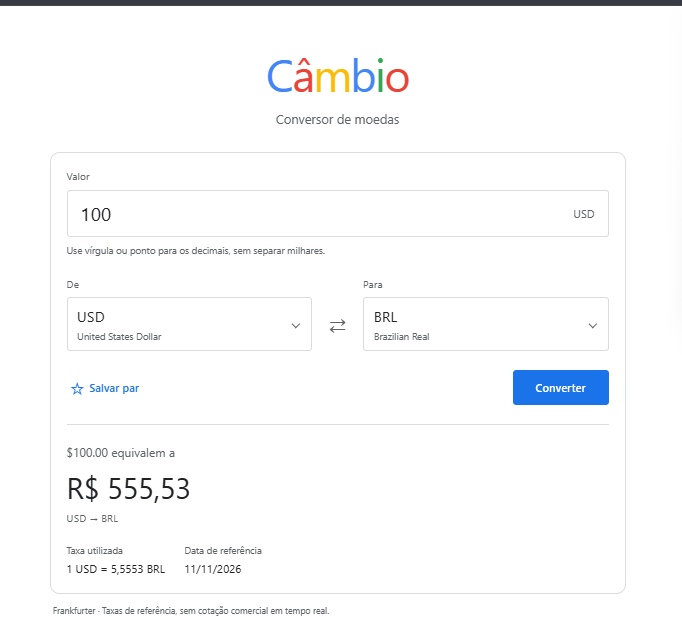
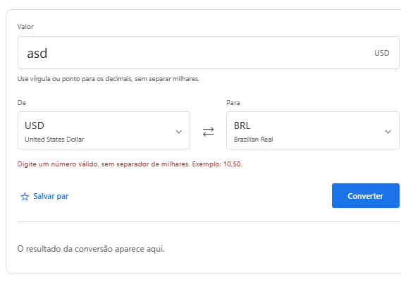
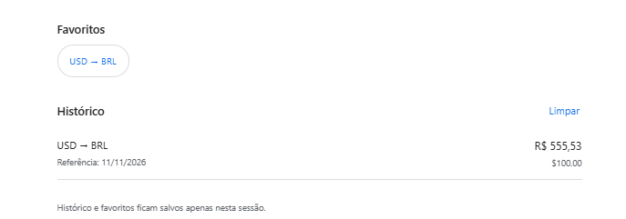

# Câmbio de bolso

Conversor de moedas feito com React Native, JavaScript e Expo. Você informa um valor, escolhe as duas moedas e consulta a taxa da Frankfurter. O resultado mostra o valor original, o valor convertido, a taxa utilizada e sua data de referência.

As taxas são de referência. Elas não representam uma cotação comercial em tempo real e não incluem tarifas de bancos, casas de câmbio ou cartões.

## Instalar e executar

Use Node.js 24 — a versão usada no desenvolvimento foi a 24.22.1 — e npm. O arquivo `.nvmrc` permite selecionar a versão com `nvm use`.

```bash
git clone https://github.com/TheusBertelli/conversor-de-moedas.git
cd conversor-de-moedas
npm ci
npm start
```

Abra o QR code com uma versão do Expo Go compatível com o SDK 58 no Android ou iOS. Também é possível usar um development build compatível. O celular precisa conseguir acessar o computador que executa o Metro e a API pública.

Para abrir no navegador:

```bash
npm run web
```

Com um emulador Android já configurado, use `npm run android`. Para o simulador de iOS, use `npm run ios` em um Mac com Xcode instalado. Esses comandos não instalam o Android SDK nem o Xcode.

Não é necessário criar conta na Frankfurter, configurar `.env` ou fornecer uma chave de API. A rede precisa permitir HTTPS para `api.frankfurter.dev`; a documentação fica em [frankfurter.dev](https://frankfurter.dev/).

## Como usar

1. Digite um valor maior que zero. `10,50` e `10.50` representam o mesmo valor. Não use separadores de milhar, símbolos de moeda ou notação científica.
2. Escolha as moedas de origem e destino. A lista vem da API e pode ser pesquisada pelo código ou nome.
3. Toque em **Converter**. A consulta só começa depois da validação dos campos.
4. Confira o resultado, a taxa e a data de referência. O botão de inversão troca a direção para uma nova consulta.

É possível salvar pares na estrela e selecioná-los novamente na área de favoritos. As últimas 10 conversões aparecem no histórico, que pode ser limpo. Favoritos e histórico ficam apenas na memória da sessão; fechar ou recarregar o app apaga esses dados.

Alterar o valor ou as moedas limpa o resultado atual. Se uma consulta falhar, a tela mostra a mensagem e permite tentar novamente, sem apresentar o resultado anterior como se fosse novo. O histórico continua disponível.

Os valores são formatados pela localidade da moeda quando ela está mapeada: por exemplo, reais em `pt-BR`, dólares em `en-US` e ienes em `ja-JP`. Para as demais moedas, o padrão é `pt-BR`. Códigos que não são aceitos pelo formatador monetário, como `USDT`, aparecem junto de um número formatado.

## Organização do código

```text
App.js
src/
  models/
    frankfurter.js
  viewmodels/
    conversion.js
    useConverterViewModel.js
  views/
    ConverterScreen.js
    CurrencyPicker.js
    ConversionResult.js
    ConversionHistory.js
    colors.js
tests/
```

| Camada    | Responsabilidade                                                                                                            |
| --------- | --------------------------------------------------------------------------------------------------------------------------- |
| Model     | Faz as requisições, verifica o HTTP e valida o formato dos dados recebidos.                                                 |
| ViewModel | Guarda os estados, valida os campos, coordena as consultas e calcula `valor × taxa`. Também controla histórico e favoritos. |
| View      | Renderiza campos, seletores, carregamento, erros e resultado. Encaminha as ações ao ViewModel.                              |
| `App.js`  | Integra a tela principal aos componentes de inicialização do aplicativo.                                                    |

Para alterar a aparência de um botão, edite a View. Para mudar uma regra de entrada, edite `conversion.js`. Para mudar o acesso à API, edite o Model. A View não faz `fetch`. O resultado e o histórico têm componentes próprios, e as cores compartilhadas ficam em `colors.js`.

O aplicativo usa a API v2:

- `GET /v2/currencies`: recebe a lista com `iso_code` e `name`, usada nos seletores.
- `GET /v2/rate/{origem}/{destino}`: recebe `{ date, base, quote, rate }` para calcular a conversão na direção escolhida.

O endpoint `/v2/rates?base=USD&quotes=BRL`, citado no enunciado, é uma alternativa ao segundo endpoint; não é necessário consultar os dois para a mesma conversão. Não há taxas fixas nem uma lista local usada como substituta da API em produção.

Cada requisição tem um limite de 15 segundos. O Model distingue falha de conexão, HTTP de erro, JSON inválido e dados incompatíveis. O ViewModel cancela consultas quando os campos mudam ou a tela é desmontada e descarta respostas antigas. O cálculo usa o número recebido da API; o arredondamento é feito apenas na apresentação.

## Verificação

```bash
npm run format:check
npm run lint
npm test
npm run build:web
```

`npm run check` executa os quatro comandos em sequência. A suíte de Model, ViewModel e formatação contém 78 testes; os testes de interface têm 16 cenários, divididos entre celular e desktop. Para desenvolver os testes, use `npm run test:watch`.

O ESLint verifica os padrões de JavaScript e React. O Prettier mantém aspas simples, vírgulas finais e quebra de linha consistente. Execute `npm run format` para formatar os arquivos antes de commitar. As responsabilidades seguem o MVVM, com nomes descritivos e componentes separados por função.

Os testes em `tests/` cobrem validação, formatação, contrato da API, erros, cancelamento, conversão, histórico e favoritos. As requisições são simuladas nos testes para exercitar cenários sem depender da disponibilidade da Frankfurter. Isso não substitui a verificação de uma consulta real nem a execução em dispositivo Android ou iOS.

A relação entre o enunciado, a implementação e as verificações está em [docs/requisitos.md](docs/requisitos.md).

Para os testes pela interface, compile a versão web e instale o Chromium do Playwright uma vez:

```bash
npm run build:web
npx playwright install chromium
npm run test:e2e
```

Os mesmos cenários rodam em larguras de celular e desktop. Para atualizar as capturas dos testes automatizados no Linux/macOS, execute `UPDATE_SCREENSHOTS=1 npm run test:e2e`. Em uma máquina que já tenha Chromium, é possível indicar o executável com `PLAYWRIGHT_CHROMIUM_EXECUTABLE_PATH`.

Para verificar o acesso à API real, sem respostas simuladas, use Node 24 e execute:

```bash
npm run test:api
```

A integração contínua em `.github/workflows/ci.yml` executa verificação de formatação, lint, testes, build web e os testes de interface a cada push em `main` ou pull request. A consulta à API real fica separada para não depender de um serviço externo em cada execução.

## Interface e referências

O layout segue a simplicidade das páginas do Google: fundo branco, conteúdo centralizado, bordas cinza e controles azuis. O nome Câmbio usa letras coloridas, sem reproduzir o logotipo do Google. Campos, seletores e botões continuam feitos com componentes do React Native; o Material Web foi usado como referência visual, não como dependência.

Referências consultadas:

- Material Design: [campos de texto](https://github.com/material-components/material-web/blob/main/docs/components/text-field.md), [botões](https://github.com/material-components/material-web/blob/main/docs/components/button.md) e [papéis de cor](https://github.com/material-components/material-web/blob/main/docs/theming/color.md).
- React: [funções retornadas por hooks personalizados](https://react.dev/reference/react/useCallback#optimizing-a-custom-hook).

## Capturas de tela

Capturas fornecidas pelo autor durante o uso da versão web do aplicativo.

### Conversão de moedas

Conversão de 100 USD para BRL, com o resultado, a taxa utilizada e a data de referência.



### Validação de entrada

Ao digitar um texto no campo de valor, o aplicativo orienta o usuário e não apresenta um resultado de conversão.



### Favoritos e histórico

Par USD → BRL salvo nos favoritos e conversão registrada no histórico da sessão.



### Capturas dos testes automatizados

As imagens de [largura mobile](docs/screenshots/conversao-mobile.png) e [desktop](docs/screenshots/conversao-desktop.png) usam respostas controladas de teste. O comando `UPDATE_SCREENSHOTS=1 npm run test:e2e` atualiza apenas esses dois arquivos; as capturas fornecidas pelo autor são preservadas.

As instruções específicas desta máquina estão em [docs/ambiente-nuvem.md](docs/ambiente-nuvem.md).
